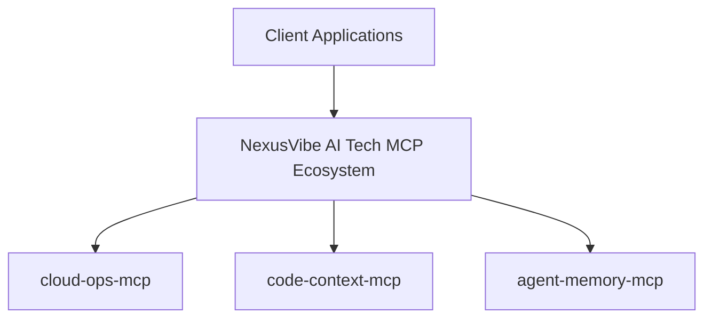
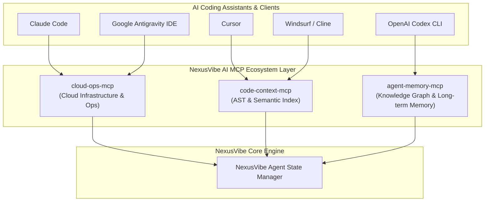

# Hi there, I'm Dhruv 👋
<div align="center">
  

  <br />
  <br />

  `Ecosystem: NexusVibe AI` • `MCP Standard: 2025-03-26` • `Python 3.10+` • `License: MIT`
</div># Hi there, I'm NexusVibe AI Tech 👋
<div align="center">
  

  <br />
  <br />

  `Ecosystem: NexusVibe AI Tech` • `MCP Standard: 2025-03-26` • `Python 3.10+` • `License: MIT`
</div>

<br />

# Hi there, I'm NexusVibe AI Tech 👋
### Founder & AI Architect @ **NexusVibe AI Tech**

Building Agent-Native Model Context Protocol (MCP) Servers, Autonomous Workflows & Scalable Cloud Systems.

---

## ⚡ NexusVibe AI Tech Open-Source MCP Ecosystem

| MCP Repository | Description | Key Capabilities | Quick Install |
| :--- | :--- | :--- | :--- |
| **[`cloud-ops-mcp`](/nexusvibe-ai/cloud-ops-mcp)** | Cloud Infrastructure & Operations Management | AWS/GCP provisioning, log analysis, deployment automation, incident response | `claude mcp add cloud-ops-mcp` |
| **[`code-context-mcp`](/nexusvibe-ai/code-context-mcp)** | Deep Codebase Context & Semantic Indexing | AST parsing, dependency graph analysis, real-time code search, symbol lookup | `claude mcp add code-context-mcp` |
| **[`agent-memory-mcp`](/nexusvibe-ai/agent-memory-mcp)** | Persistent Long-term Memory & Knowledge Graph | Entity extraction, graph storage, vector search, multi-session state preservation | `claude mcp add agent-memory-mcp` |

---

## 🏗️ Architectural Topology



<br />

# Hi there, I'm Dhruv 👋
### Founder & AI Architect @ **NexusVibe AI**

Building Agent-Native Model Context Protocol (MCP) Servers, Autonomous Workflows & Scalable Cloud Systems.

---

## ⚡ NexusVibe AI Open-Source MCP Ecosystem

| MCP Repository | Description | Key Capabilities | Quick Install |
| :--- | :--- | :--- | :--- |
| **[`cloud-ops-mcp`](/nexusvibe-ai/cloud-ops-mcp)** | Cloud Infrastructure & Operations Management | AWS/GCP provisioning, log analysis, deployment automation, incident response | `claude mcp add cloud-ops-mcp` |
| **[`code-context-mcp`](/nexusvibe-ai/code-context-mcp)** | Deep Codebase Context & Semantic Indexing | AST parsing, dependency graph analysis, real-time code search, symbol lookup | `claude mcp add code-context-mcp` |
| **[`agent-memory-mcp`](/nexusvibe-ai/agent-memory-mcp)** | Persistent Long-term Memory & Knowledge Graph | Entity extraction, graph storage, vector search, multi-session state preservation | `claude mcp add agent-memory-mcp` |

---

## 🏗️ Ecosystem Architecture



---

## 🚀 Quick Start Commands

```bash
# Install NexusVibe AI MCP Servers into Claude Code CLI
claude mcp add cloud-ops-mcp -- python -m cloud_ops_mcp
claude mcp add code-context-mcp -- python -m code_context_mcp
claude mcp add agent-memory-mcp -- python -m agent_memory_mcp
```

### Cursor Setup (`.cursor/mcp.json`)
```json
{
  "mcpServers": {
    "cloud-ops": { "command": "python", "args": ["-m", "cloud_ops_mcp"] },
    "code-context": { "command": "python", "args": ["-m", "code_context_mcp"] },
    "agent-memory": { "command": "python", "args": ["-m", "agent_memory_mcp"] }
  }
}
```

---

## 🛠️ Tech Stack & Focus Areas

- **AI & MCP:** Model Context Protocol, Autonomous Agent Frameworks, Vector DBs, RAG, Knowledge Graphs
- **Languages & Frameworks:** Python, TypeScript, Go, Rust, React, Next.js, FastAPI
- **Cloud & DevOps:** AWS, GCP, Kubernetes, Terraform, Docker, CI/CD Pipelines

**Full-Stack Software Engineer & AI Architect**

---

### 🚀 Featured Open-Source Python MCP Servers
*(Compatible with Cursor, OpenAI Codex CLI, Google Antigravity IDE, Claude Desktop, Claude Code & Windsurf)*

| Server | Description | Tools / Capabilities |
| :--- | :--- | :--- |
| `cloud-ops-mcp` | Cloud Infrastructure & Operations Management via Model Context Protocol | AWS/GCP resource provisioning, log analysis, deployment automation, incident response |
| `code-context-mcp` | Deep Codebase Context & Semantic Indexing for AI Coding Assistants | AST parsing, dependency graph analysis, real-time code search, symbol lookup |
| `agent-memory-mcp` | Persistent Long-term Memory & Knowledge Graph for Autonomous Agents | Entity extraction, graph storage, vector search, multi-session state preservation |

---

### 🛠️ Core Expertise

| Domain | Key Skills & Technologies |
| :--- | :--- |
| **AI & MCP Engineering** | Python, Model Context Protocol (MCP), LLM Tool Integration, RAG, Agentic Workflows |
| **Frontend** | React, Next.js, TypeScript, Tailwind CSS, Web Components |
| **Backend & Cloud** | Node.js, Python (FastAPI/Django), Go, Microservices, AWS, GCP, Docker, Kubernetes |
| **Security & DevOps** | CI/CD Pipelines, Infrastructure as Code (Terraform), Zero Trust Architecture, AppSec |
