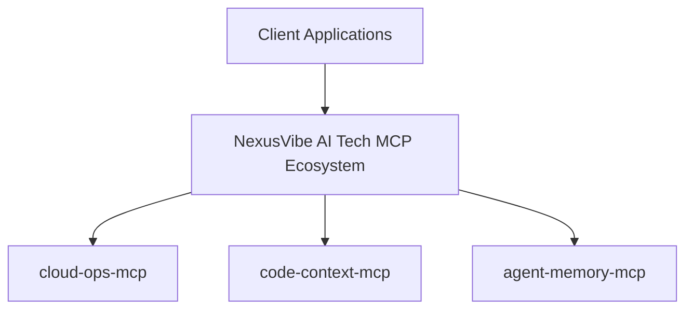

  

# Hi there, I'm Jitendra Kumar 👋
### Founder & AI Architect @ **NexusVibe AI Tech**

Building Agent-Native Model Context Protocol (MCP) Servers, Autonomous Workflows & Scalable Cloud Systems.

---

## ⚡ NexusVibe AI Tech Open-Source MCP Ecosystem

| MCP Repository | Description | Key Capabilities | Quick Install |
| :--- | :--- | :--- | :--- |
| **[`cloud-ops-mcp`](/jitendrakumar-ai/cloud-ops-mcp)** | Cloud Infrastructure & Operations Management | AWS/GCP provisioning, log analysis, deployment automation, incident response | `claude mcp add cloud-ops-mcp` |
| **[`code-context-mcp`](/jitendrakumar-ai/code-context-mcp)** | Deep Codebase Context & Semantic Indexing | AST parsing, dependency graph analysis, real-time code search, symbol lookup | `claude mcp add code-context-mcp` |
| **[`agent-memory-mcp`](/jitendrakumar-ai/agent-memory-mcp)** | Persistent Long-term Memory & Knowledge Graph | Entity extraction, graph storage, vector search, multi-session state preservation | `claude mcp add agent-memory-mcp` || **`nexus-serena-mcp`** | IDE Toolkit & Live Documentation Engine | Symbol AST lookup, surgical refactoring, docstrings, project onboarding | `claude mcp add nexus-serena-mcp` |

---

## 🏗️ Architectural Topology

